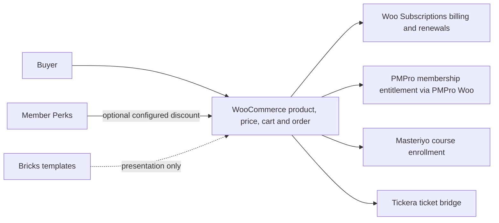

# 1. Executive Summary

**Inspection date:** 2026-11-19  
**Runtime:** `vgnova-local-10039`, LocalWP WordPress root `/home/jcschoeman96/Local Sites/voelgoed-novamira/app/public`  
**Database:** MySQL Community Server 8.0.35, database `local`, prefix `wp_`; actual socket `/home/jcschoeman96/.config/Local/run/nAZNpFs99/mysql/mysqld.sock`  
**Repository baseline:** `main` at `454346d9e6a2c36864a4bbd944e52596f16e09c1`, matching `origin/main` per the parent baseline.

WooCommerce configuration is **partially complete**. The runtime contains 24 parent products and 14 published variations, including four published Masteriyo course products, seven draft variable-subscription parents mapped to PMPro levels, four published test event-ticket products, physical catalogue drafts, and QA fixtures. Product records carry ZAR price metadata, but this is configuration evidence, not proof of what a current public page renders.

The strongest commerce blocker is payment availability. The current selected configuration has the Woo Order Test gateway enabled and its administrator bypass enabled; PayPal and cash-on-delivery are disabled. The latest VGN-18 browser comment (2026-11-17 15:39 UTC) says a guest checkout form rendered at `/checkout/` without an SSL error but offered **no payment methods**. No checkout was submitted. No real WooCommerce payment gateway was observed enabled. This is not an end-to-end purchase pass.

Tax calculation is off and the tax-rate table returned zero rows, although priced products are marked taxable and shop/cart prices are set to display excluding tax. Shipping has one South Africa zone with enabled free shipping and no configured minimum. Effective checkout totals and shipping were not exercised.

Course-to-product references are reciprocal for four published course pairs: 534↔1938, 536↔1937, 538↔1936, and 540↔1935. Course 532 and synthetic Course 1889 have no Woo product. Tickera Event 763 has four published Woo test products; separate Tickera-native test tickets map to Events 1189, 1191, and 1193. None of these mappings proves a successful order, membership grant, course enrollment, ticket fulfillment, or renewal.

**Coverage:** PARTIAL. Product/configuration and source lifecycle inspection are strong; live payment, route, subscription, order, email-delivery and fulfillment behavior remain unverified. **Overall confidence:** MEDIUM; high for the selected current database values and inspected installed code, low for behavior because no application route or transaction was exercised.

# 2. Inspection Scope and Evidence

## Scope and safety

Read the full `docs/evaluation/COORDINATION_BRIEF_v0.1.0.md`, `PARENT_BASELINE_v0.1.0.md`, repository `AGENTS.md`, the applicable nested instructions, the prior runtime foundation and plugin inventory reports, the locked product-tech specification, and the current commerce/course architecture references. Read the live VGN-18 and VGN-53 issues and latest comments, not only their issue bodies. Read current VGN-19 as a related course-fulfillment reference.

Runtime evidence came from a purpose-built PHP 8.5 `mysqli` client that parsed WordPress DB configuration into process memory and issued bounded `SELECT` queries through the registered LocalWP MySQL socket. The actual database batches were invoked as `flock -n /tmp/vgnova-evaluation-read.lock php8.5` with the client on stdin. Expensive query batches were serialized with:

```sh
flock -n /tmp/vgnova-evaluation-read.lock <read-only-command>
```

Only selected Woo options, product/course/event metadata, tax/shipping metadata, template IDs and aggregate counts were emitted. The database password was not printed, logged, or placed in command arguments. The client did not bootstrap WordPress or load plugins. Static runtime code was read directly from the installed plugin and MU-plugin files.

No customer/user details, credential values, order records, payments, subscription records, carts, Woo sessions, checkout payloads, or email addresses were inspected. No WordPress page GET or browser call was made. A product/checkout GET can bootstrap WordPress/WooCommerce and create or change session state; without an approved side-effect assessment, current route behavior is marked UNKNOWN. No settings, products, templates, plugin state, orders, or database rows were changed. No tests or transactions were run.

## Evidence labels

- **RUNTIME_CONFIRMED** — selected live database or installed runtime-file state observed directly.
- **SOURCE_CONFIRMED** — current repository or installed source code observed; not proof that a path ran.
- **BOTH_CONFIRMED** — the relevant source contract and current runtime configuration agree.
- **HISTORICAL_ONLY** — issue/comment evidence from its stated date, not revalidated in a current page request.
- **INFERRED** — interpretation of observed configuration/code, not directly exercised behavior.
- **UNKNOWN** — not established safely in this inspection.
- **CONFLICT** — observed sources disagree or a tracker description is stale.

## Plane evidence

| Reference | Current issue state and evidence | Assessment |
|---|---|---|
| VGN-18, `fac5419e-4347-418a-a1c2-15054dde2e91`, COMM-COURSE | Current state `Blocked` (workflow group `unstarted`). Latest comment `ac9fc988-d58d-4c40-97a9-be117bfa8e6f`, 2026-11-17 15:39:18 UTC: checkout form rendered at `http://localhost:10039/checkout/`, no SSL error, no payment methods, no order submitted. Prior comment `621d6607-6776-4a80-9e4e-c71f3dd46df4`, 15:21 UTC, records owner-executed one-option SSL setting change from yes to no. | HISTORICAL_ONLY browser evidence; current DB independently confirms `woocommerce_force_ssl_checkout=no`. The latest comment supersedes the stale issue-body claim that all five published courses were unlinked: current SQL confirms four linked pairs and a fifth ordinary published Course 532 unlinked; an additional synthetic Course 1889 is published and unlinked. |
| VGN-53, `f380b9e6-2baa-4320-af95-7daf2bd1d6b8` | Current state `Backlog`, updated 2026-11-17 12:24 UTC; no comments. Body records Product 1935 permalink as returning 404 on Nov. 17. | HISTORICAL_ONLY route observation; no current GET was made. The current configured permalink is `http://localhost:10039/winkel/mindfulness-vir-vroue/`. |
| VGN-19, `70184eaf-3cc8-4300-b719-1ed720bf3f35` | Current state `Blocked`; issue body describes Masteriyo order-link and email-marker risks; no comments. | Related context only. Installed current code was inspected independently below; no course enrollment or email was exercised. |

# 3. Component Inventory

Plugin versions below come from the current runtime inventory in `docs/evaluation/02_PLUGIN_INVENTORY_v0.1.0.md`; state and configuration were corroborated by the selected runtime reads where noted.

| Component | ID/Slug/Path | State | Owner | Purpose | Consumers | Evidence |
|---|---|---|---|---|---|---|
| WooCommerce | Plugin 11.3.0; `product`; `/winkel/` | Active; 24 parent products, 14 published variations; ZAR | Product/catalogue price, cart, checkout and order authority | Bricks product/cart/checkout templates; PMPro bridge; Masteriyo integration; Tickera bridge; Member Perks adapter | RUNTIME_CONFIRMED; selected DB inventory and 02 plugin inventory |
| WooCommerce Subscriptions | Plugin 9.4.1; `variable-subscription` | Active; seven parent products are draft; 14 child variations published | Recurring billing, renewal orders, subscription statuses | PMPro Woo membership bridge; My Account and native subscription emails/templates | RUNTIME_CONFIRMED for plugin/config; no subscription rows read |
| Woo Order Test | Plugin 4.2; gateway `wpfi_woo_order_test` | Active, gateway enabled; administrator bypass enabled | Local administrator-only test path | Woo checkout/thank-you hooks | RUNTIME_CONFIRMED option; SOURCE_CONFIRMED code; guest payment behavior historically unavailable |
| PMPro | Plugin 3.9.1 | Active; selected PMPro gateway option `paystack` | Membership entitlement/status authority | Membership dashboard, PMPro Woo addon, Member Perks | RUNTIME_CONFIRMED selected option; no membership records read |
| PMPro WooCommerce | Plugin 1.11; `_pmprowoo_product_levels` | Active; seven parent products map to PMPro levels 15–21 | Applies/cancels/reactivates mapped PMPro levels from Woo order/subscription events | Woo product/order lifecycle and PMPro memberships | RUNTIME_CONFIRMED mapping; installed source lines 207–496 |
| Masteriyo | Plugin 3.5.1; `mto-course` | Active; six published course records (one synthetic), one trash; four product links confirmed | Course delivery/enrollment authority | Woo `mto_course` products and Masteriyo student emails | RUNTIME_CONFIRMED records/config; SOURCE_CONFIRMED installed integration |
| Tickera | Plugin 3.6.0.9; `tc_events`, `tc_tickets` | Active; 17 published event records; native test-ticket mappings found | Event/ticket identity and attendee/ticket fulfillment | Bricks event templates; Woo ticket bridge | RUNTIME_CONFIRMED selected mappings; no attendee/order records read |
| Tickera Woo bridge | Plugin 1.8.0; `bridge-for-woocommerce.php` | Active | Bridges Woo product/order handling to Tickera ticket products | Four Woo test products mapped to Event 763 | RUNTIME_CONFIRMED mapping; SOURCE_CONFIRMED runtime bridge code |
| Voelgoed Member Perks | Source submodule 0.18.0 at `972a279be7a753594888e974132562e1cc099e24`; runtime plugin path | Active; discount, initial-subscription discount, course-claim, ticket-claim, notification and Woo Blocks flags off; hub and runtime-status cron on; environment mode says `production` on this LocalWP staging site | Member benefit/discount authority; does not own Woo base prices | Woo cart price adapter, Bricks membership hub, course/ticket claims | RUNTIME_CONFIRMED selected ACF options; mode effect UNKNOWN; source/runtime hashes in §6 |
| Course product route adapter | `wp-content/mu-plugins/vg-masteriyo-course-products.php` | Active in runtime; no matching source path found in the repository file search | Redirects linked product singles to course URLs and excludes course products from catalog queries | Woo product routes and shop/category queries | SOURCE_CONFIRMED runtime code, source owner UNKNOWN; route behavior not tested |
| Bricks commerce templates | DB IDs 79, 80, 113, 114, 120, 124, 128, 1733 | All listed as published | Presentation only | Woo Cart, Checkout, My Account forms, product, Thank You; Masteriyo course | RUNTIME_CONFIRMED selected DB records; rendered behavior only historically tested for checkout form |

# 4. Current Architecture and Configuration

## Product catalogue

The values below are **stored runtime configuration**. “Current” means the Woo `_price` value (the sale value when present); it does not assert that the product is currently reachable or purchasable in the public UI. All displayed amounts use configured store currency ZAR. Prices, category and attribute values were selected directly from the DB; customer or order data was not queried.

| ID | Product / slug | Woo type; status | Demo/test indication | Category | Regular / sale / current | Tax, delivery and link notes |
|---:|---|---|---|---|---|---|
| 525 | Aromaterapie Kersstel / `aromaterapie-kersstel` | simple; pending | None found in inspected marker keys | Uncategorized | R189 / — / R189 | Taxable; physical; not downloadable |
| 527 | Inspirasie Dagboek / `inspirasie-dagboek` | simple; pending | None found in inspected marker keys | Uncategorized | R129 / — / R129 | Taxable; physical; not downloadable |
| 529 | Omega-3 Vitamiene (60) / `omega-3-vitamiene` | simple; pending | None found in inspected marker keys | Uncategorized | R249 / — / R249 | Taxable; physical; not downloadable |
| 531 | Slaapmasker Deluxe / `slaapmasker-deluxe` | simple; pending | None found in inspected marker keys | Uncategorized | R99 / — / R99 | Taxable; physical; not downloadable |
| 642 | QA Product No Excerpt Image | simple; trash | QA title | None | No price metadata | Trashed |
| 765 | Test Event Recording | simple; trash | Test title | None | No price metadata | Trashed |
| 767 | Test Event Recording QA2 | simple; pending | Test/QA title | None | No regular/current price metadata | Taxable; physical; not downloadable |
| 768 | QA4 | simple; trash | QA title | None | No price metadata | Trashed |
| 842 | Event Test / `event-test` | simple; publish | Test title; `_tc_is_ticket=yes` | Uncategorized | R9,999 / R999 / R999 | Taxable; physical; linked to Tickera Event 763 |
| 844 | Event Test 2 / `event-test-2` | simple; publish | Test title; `_tc_is_ticket=yes` | Uncategorized | R9,999 / R999 / R999 | Taxable; physical; linked to Tickera Event 763 |
| 845 | Event Test 3 / `event-test-3` | simple; publish | Test title; `_tc_is_ticket=yes` | Uncategorized | R9,999 / R999 / R999 | Taxable; physical; linked to Tickera Event 763 |
| 846 | Event Test 4 / `event-test-4` | simple; publish | Test title; `_tc_is_ticket=yes` | Uncategorized | R9,999 / R999 / R999 | Taxable; physical; linked to Tickera Event 763 |
| 905 | Voelgoedvriendinne Brons / `voelgoedvriendinne-brons` | variable-subscription; draft | No explicit test flag found | Uncategorized | Parent `_price` R240; variation prices below | Taxable; parent physical flag=no, variations virtual; PMPro level 15 |
| 908 | Voelgoedvriendinne Silwer / `voelgoedvriendinne-silver` | variable-subscription; draft | No explicit test flag found | Uncategorized | Parent `_price` R390; variation prices below | Taxable; parent physical flag=no, variations virtual; PMPro level 16 |
| 911 | Voelgoedvriendinne Goud / `voelgoedvriendinne-goud` | variable-subscription; draft | No explicit test flag found | Uncategorized | Parent `_price` R790; variation prices below | Taxable; parent physical flag=no, variations virtual; PMPro level 17 |
| 914 | Voelgoednetwerk Brons / `voelgoednetwerk-brons` | variable-subscription; draft | No explicit test flag found | Uncategorized | Parent `_price` R740; variation prices below | Taxable; parent physical flag=no, variations virtual; PMPro level 18 |
| 917 | Voelgoednetwerk Silwer / `voelgoednetwerk-silver` | variable-subscription; draft | No explicit test flag found | Uncategorized | Parent `_price` R1,440; variation prices below | Taxable; parent physical flag=no, variations virtual; PMPro level 19 |
| 920 | Voelgoednetwerk Goud / `voelgoednetwerk-goud` | variable-subscription; draft | No explicit test flag found | Uncategorized | Parent `_price` R2,240; variation prices below | Taxable; parent physical flag=no, variations virtual; PMPro level 20 |
| 923 | Voelgoednetwerk Platinum / `voelgoednetwerk-platinum` | variable-subscription; draft | No explicit test flag found | Uncategorized | Parent `_price` R3,440; variation prices below | Taxable; parent physical flag=no, variations virtual; PMPro level 21 |
| 1186 | [QA] Unified Dashboard Subscription Fixture / `qa-unified-dashboard-subscription-fixture` | simple; private | QA title; excluded from catalog and search | Uncategorized | R1 / — / R1 | Taxable; virtual; not downloadable; simple product, not a Woo Subscription |
| 1935 | Mindfulness vir Vroue / `mindfulness-vir-vroue` | `mto_course`; publish | Course product | Uncategorized | R199 / R149 / R149 | Taxable; virtual and downloadable; linked to Course 540 |
| 1936 | Gesonde Huwelik: Kommunikasie / `gesonde-huwelik-kommunikasie` | `mto_course`; publish | Course product | Uncategorized | R399 / R299 / R299 | Taxable; virtual and downloadable; linked to Course 538 |
| 1937 | Finansiële Vryheid Basiese / `finansiele-vryheid-basiese` | `mto_course`; publish | Course product | Uncategorized | R449 / — / R449 | Taxable; virtual and downloadable; linked to Course 536 |
| 1938 | Geloof & Identiteit / `geloof-identiteit` | `mto_course`; publish | Course product | Uncategorized | R299 / — / R299 | Taxable; virtual and downloadable; linked to Course 534 |

**Counts:** 24 parent products: 13 simple, 7 variable-subscription, and 4 `mto_course`; 8 published, 7 draft, 5 pending, 1 private, 3 trash. Fourteen child variations are published. The seven parent subscription products are draft even though their variations are published; parent draft status means those variations are not evidence of a public offer. No product-level demo/test flag was found among the inspected markers; the table labels test/QA items using titles and the Tickera/course links. No product tags, additional product-category assignments, or other product attributes were observed. The only configured product category on records with terms is `uncategorized`; subscription parents define the one local custom attribute `Betalingstermyn`.

All priced products were in stock according to stored `_stock_status`; individual product stock management was off. The global stock-management option is on, with a 10,080-minute hold-stock value. The four course products are virtual/downloadable. The test event and ordinary physical products are virtual=no. The subscription parent records are virtual=no while each subscription variation is virtual=yes. No shipping class was assigned in the selected product records.

### Subscription variation prices and attribute values

All 14 variations are `publish`, taxable, inherit parent tax class, virtual, not downloadable, and use local custom attribute `Betalingstermyn` with variation key `attribute_betalingstermyn`. Current amounts below are stored regular/sale/current values; period is unlimited (`subscription_length=0`), signup fee and trial are zero, and interval is one.

| Variation ID | Parent | Billing attribute / period | Regular / sale / current |
|---:|---:|---|---|
| 906 | 905 Brons | Maandeliks / month | R39 / R24 / R24 |
| 907 | 905 Brons | Jaarliks / year | R390 / R240 / R240 |
| 909 | 908 Silwer | Maandeliks / month | R59 / R39 / R39 |
| 910 | 908 Silwer | Jaarliks / year | R590 / R390 / R390 |
| 912 | 911 Goud | Maandeliks / month | R99 / R79 / R79 |
| 913 | 911 Goud | Jaarliks / year | R990 / R790 / R790 |
| 915 | 914 Voelgoednetwerk Brons | Maandeliks / month | R94 / R74 / R74 |
| 916 | 914 Voelgoednetwerk Brons | Jaarliks / year | R940 / R740 / R740 |
| 918 | 917 Voelgoednetwerk Silwer | Maandeliks / month | R194 / R144 / R144 |
| 919 | 917 Voelgoednetwerk Silwer | Jaarliks / year | R1,940 / R1,440 / R1,440 |
| 921 | 920 Voelgoednetwerk Goud | Maandeliks / month | R299 / R224 / R224 |
| 922 | 920 Voelgoednetwerk Goud | Jaarliks / year | R2,990 / R2,240 / R2,240 |
| 924 | 923 Voelgoednetwerk Platinum | Maandeliks / month | R444 / R344 / R344 |
| 925 | 923 Voelgoednetwerk Platinum | Jaarliks / year | R4,440 / R3,440 / R3,440 |

The parent `_product_attributes` metadata exposes `Betalingstermyn` values `Maandeliks | Jaarliks`. No member discount feature is active in the selected current flags; the stored sale values above are product prices, not proof of Member Perks behavior.

## Course and Event mappings

| Record | Runtime relation | Status and pricing | Evidence / limit |
|---|---|---|---|
| Masteriyo Course 534 ↔ Woo Product 1938 | Reciprocal `_wc_product_id` / `_masteriyo_course_id` | Course publish; product publish; R299 current product price | BOTH_CONFIRMED config; no order/access test |
| Masteriyo Course 536 ↔ Woo Product 1937 | Reciprocal metadata | Course publish; product publish; R449 current product price | BOTH_CONFIRMED config; no order/access test |
| Masteriyo Course 538 ↔ Woo Product 1936 | Reciprocal metadata | Course publish; product publish; R299 current product price | BOTH_CONFIRMED config; no order/access test |
| Masteriyo Course 540 ↔ Woo Product 1935 | Reciprocal metadata | Course publish; product publish; R149 current product price (R199 regular) | BOTH_CONFIRMED config; route was historically reported 404; current route UNKNOWN |
| Course 532 | No Woo product link | Publish; no linked product observed | RUNTIME_CONFIRMED |
| Course 1889 | Synthetic/QA course; no Woo product link | Publish; no linked product observed | RUNTIME_CONFIRMED; synthetic designation from prior VGN-18 comment |
| Course 438 | No link assessed | Trash | RUNTIME_CONFIRMED |

The course data consists of six published records (five ordinary IDs plus synthetic Course 1889) and one trashed course. Product 1935’s configured permalink is `http://localhost:10039/winkel/mindfulness-vir-vroue/`; the MU-plugin redirects a linked published product single to the course permalink and excludes linked course products from Woo catalogue queries (runtime file lines 130–185). That code is SOURCE_CONFIRMED at runtime, but is absent from the checked-out repository file list and its current route was not requested.

Tickera has 17 published event records in the selected query. Eight configured event-category terms map as follows: Event 151 `aanlyn`, 163 `kompetisies`, 164 `feeste`, 165 `funksies`, 166 `sport`, 167 `vertonings`, 172 `reise`, and 181 `werkswinkels`. Other published event rows observed were 542 (`funksies`), 545 (`werkswinkels`), 548 (`feeste`), 551 (`aanlyn`), 554 (`reise`), and test/QA events 763, 1189, 1191, 1193 (no category assigned). Four Woo test products 842, 844, 845, 846 all carry `_tc_is_ticket=yes` and `_event_name=763`. Separate Tickera-native test tickets 1195, 1196 and 1197 map to events 1189, 1191 and 1193; those Tickera ticket records have no Woo price. No attendee, order or ticket-fulfillment data was inspected.

## Store, tax, shipping and checkout configuration

| Area | Current selected configuration | Evidence status |
|---|---|---|
| Currency and price display | Currency ZAR; two decimals; prices entered excluding tax; shop/cart display excluding tax | RUNTIME_CONFIRMED selected options |
| Tax | `woocommerce_calc_taxes=no`; basis shipping; product rows taxable with standard/parent class; tax-rate table has zero rows | RUNTIME_CONFIRMED config; actual totals not tested |
| Shipping | One South Africa zone; one enabled `free_shipping` method; no minimum amount; destination billing; shipping-cost requirement does not require an address; calculator enabled | RUNTIME_CONFIRMED config; rate calculation not tested |
| Public product route | Product base `/winkel`; course product 1935 has configured slug `mindfulness-vir-vroue` | RUNTIME_CONFIRMED settings/metadata; current HTTP response UNKNOWN |
| Cart / Checkout / My Account pages | Page 72 Cart (published, Woo Cart block); 73 Checkout (published, Woo Checkout block); 74 My Account (published, `[woocommerce_my_account]`) | RUNTIME_CONFIRMED configuration |
| Bricks page templates | 79 Cart `wc_cart`; 80 Checkout `wc_form_checkout`; 113 Login; 114 Lost Password; 120 Reset Password; 124 Single Product `wc_product`; 128 Thank You `wc_thankyou`; 1733 Masteriyo Single Course; all published | RUNTIME_CONFIRMED template records; render not tested |
| Guest/account | Guest checkout yes; checkout login reminder yes; account signup from checkout yes; My Account registration no; generate username yes; generate password no; delayed account creation option not set; SSL checkout no | RUNTIME_CONFIRMED selected options; only historical checkout form render |
| Subscriptions | Manual renewals=no; turn-off-automatic-payments=no; failed-payment retry=no; early renewal and early-renewal modal=no; zero-initial-payment-requires-payment=no; subscriber role `subscriber`; cancelled role `customer` | RUNTIME_CONFIRMED selected options; effective renewal/role behavior not tested |
| Order behavior | Coupons enabled; stock management enabled; hold-stock 10,080 minutes; default order-status override not set; HPOS enabled and HPOS data-sync option no | RUNTIME_CONFIRMED options; no order rows read |
| Store visibility | Coming-soon option no; store-pages-only option yes | RUNTIME_CONFIRMED selected options; visibility effect not rendered |

The South Africa free-shipping method’s option has an empty requirement and `min_amount=0`; this describes configuration, not the amount Woo showed to any shopper. The test event products and subscription parents are stored as non-virtual, while subscription variations and course products are virtual. Whether Woo applies shipping to a selected variation or Tickera product in the configured checkout was not tested.

## Payment gateway configuration vs guest availability

| Gateway / provider | Configured state | Guest availability / behavior |
|---|---|---|
| Woo Order Test (`wpfi_woo_order_test`) | Active plugin; Woo setting enabled=yes; `admin_payment_bypass_enabled=yes` | VGN-18 latest browser comment says guest checkout had no available methods. Installed `process_payment()` calls `payment_complete()` only for administrators and shows an error for non-admins (`woo-order-test/admin/functions.php:152–163`). Therefore enabled configuration is not evidence of a usable guest payment method. |
| Cash on delivery | Woo gateway option enabled=no | Not available by config; no checkout call made |
| PayPal | Woo gateway option enabled=no | Not available by config; no checkout call made |
| PMPro Paystack | PMPro’s selected gateway option is `paystack` | PMPro provider selection is not a configured WooCommerce gateway; no PMPro payment attempted |
| PMPro PayFast | PMPro PayFast extension active but PMPro currently selects Paystack | PMPro-only extension, not an enabled Woo gateway; not used in checkout |
| Any other Woo payment provider | No other enabled provider found in the selected gateway options | Unknown whether credentials/plugin activation or provider-specific settings exist outside selected options; no values inspected |

The test gateway’s administrator bypass filter can remove all checkout gateways for administrators and make payment unnecessary. Its thank-you callback, however, marks **any order whose thank-you route is reached by an administrator** completed; the callback does not check the order’s gateway (`woo-order-test/admin/functions.php:209–254`). This is a static code-path risk, not evidence that any order was changed. No orders were read. The test plugin’s activation hook defaults the administrator bypass option to yes (`woo-order-test/wc-ot.php:76`), consistent with the current selected value.

# 5. How It Works

## Authority path



This matches the locked product-tech decision: Woo owns base price and orders; Woo Subscriptions owns recurring billing; PMPro owns membership state; Masteriyo owns course access; Tickera owns event/ticket identity; Member Perks owns eligible benefits/discounts; Bricks presents these systems. No custom commerce subsystem was identified or proposed.

## Woo order, subscription and membership lifecycle

- WooCommerce receives the selected product and owns cart totals, order state and payment dispatch. No order state was inspected.
- Woo Subscriptions is the native recurring-billing engine. The seven configured parent products are variable subscriptions with month/year variations, zero trial/signup fee, and no set term length. Selected WCS options have manual renewals=no, automatic payments not turned off, failed-payment retry=no, and early renewal=no. The WCS source defaults retry to off unless enabled (`includes/payment-retry/class-wcs-retry-manager.php:47, 136`) and manual renewal to off (`includes/class-wcs-manual-renewal-manager.php:91–102`). These values do not prove an automatic renewal can succeed: the guest checkout had no method and the test gateway is administrator-only. No live subscription record, renewal schedule, payment attempt, or status transition was inspected.
- PMPro Woo maps parent products 905/908/911/914/917/920/923 to PMPro levels 15–21 in `_pmprowoo_product_levels`; matching `_membership_product_level` metadata was found on each parent. `pmprowoo_add_membership_from_order()` handles completed orders with mapped product IDs and an identified user, and avoids duplicating an already-active mapped level on a renewal order. `failed`, `refunded`, and `cancelled` order paths cancel mapped membership; subscription activation/on-hold-to-active reactivates it. Cancelled/trash/expired/on-hold/end-of-prepaid-term subscription paths remove the mapped PMPro level only when no other active subscription remains for that level (`pmpro-woocommerce.php:207–325, 332–371, 433–496`).
- Each of the seven parent products currently has `_membership_product_autocomplete=0`; the PMPro Woo order-autocomplete hook completes a processing order only if a cart product is marked for autocomplete (source lines 1005–1050). No order was created to test that guard.

## Woo order to Masteriyo enrollment lifecycle

Installed Masteriyo source registers order-created, order-updated, order-status-changed, and customer-created hooks (`WcIntegrationAddon.php:118–120, 172`). For a known, non-guest Woo order, it filters to product line items, skips missing products or unresolved course links, and gets or creates the UserCourse record. New records start inactive; a completed Woo order activates access and starts the enrollment clock; configured cancelled, failed and refunded states deactivate access and clear dates. A changed status to completed activates an existing record; configured unenrollment statuses deactivate it. Existing active enrollments preserve their `_wc_order_id` when a non-completed order update arrives; completed orders may update that link (`:737–831, 1265–1422`).

Guard/failure paths visible in source:

- Missing Woo functions/order, missing product/course, non-product line, and guest order with `customer_id=0` return/skip without granting access.
- The guest-account hook later searches completed guest orders when Woo creates an account; no user email or order records were inspected.
- The `maybe_link_order()` guard preserves an active enrollment’s prior order link for non-completed status, but allows a completed order to replace it. This leaves repeat-completed-order/idempotency behavior unverified.
- Product-link API requires `edit_masteriyo_courses` or `manage_options`, an existing course/product and active Woo; it rejects a product linked to a different course with 409. It writes reciprocal metadata and syncs Woo regular price into the course, then converts product type. If conversion throws, code logs the error, retains the previous product type and still returns success with that type (`:2837–2900`). This can leave a linked record whose product type did not convert; it is a static failure path, not observed for the four current products. The inspected guard checks whether the product already points to a different course, but no equivalent check is visible for a course that already points to another product before `_wc_product_id` is overwritten; relink behavior is unverified.
- Unlink removes both metadata references, but no unlink action was performed (`:2921–2947`).

## Email and fulfilment lifecycle

Masteriyo’s selected `masteriyo_settings` value has `emails.student.completed_order.enable=1`. Its Woo enrollment email class checks order/UserCourse, student existence, email availability, and a per-user/course “sent” marker; it then calls `send()` and writes the marker without checking a transport result (`WcEnrollmentEmailToStudent.php:40–99`). A failed transport may therefore be recorded as sent and suppress retry; this is a code-level risk, not evidence of failed mail. The marker is deleted when configured unenrollment statuses are processed. No email was sent or inspected.

Woo Subscriptions installs native product, account and renewal/cancellation email templates under its plugin `templates/` directory. The active Bricks child theme has no matching `woocommerce/emails` or email override path in the scoped file listing. Several selected Woo email-setting option rows are not explicitly stored; absence of those overrides does not prove core defaults are disabled. Delivery configuration, content, sender transport and duplicate-message behavior remain UNKNOWN. Bricks template 128 is a Thank You page layout, not a transactional email template.

Tickera owns event and ticket records. The Woo bridge marks Woo ticket products with Tickera metadata; the bridge and current product mapping were inspected statically. No purchase or ticket fulfillment was exercised.

# 6. Source Versus Runtime

| Domain | Source-controlled evidence | Runtime evidence | Reconciliation |
|---|---|---|---|
| Architecture authority | Locked product-tech specification assigns Woo price/order, Woo Subscriptions billing, PMPro membership, Masteriyo course access, Tickera ticketing and Member Perks benefit authority. | Corresponding plugins are active and product/link/config records exist. | BOTH_CONFIRMED for authority/configuration; runtime behavior is not established. |
| Repository baseline | `main` and `origin/main` at `454346d9e6a2c36864a4bbd944e52596f16e09c1` per parent baseline. | WordPress runtime is a separate LocalWP instance. | SOURCE_CONFIRMED; repository content must not be equated with live settings. |
| Third-party commerce plugins | WooCommerce, Woo Subscriptions, PMPro, PMPro Woo, Masteriyo, Tickera, Tickera bridge and Woo Order Test are not in the repository’s source file list. | Installed runtime plugin versions are recorded in §3. | RUNTIME_CONFIRMED; vendor plugin source is installed runtime code. |
| Member Perks | Submodule `voelgoed-member-perks` at `972a279be7a753594888e974132562e1cc099e24`. Source `WooDiscountEngine.php` SHA-256 `abe0b07c051d5f54b1879720be9d345e98ccc20c858b695e21f3595bb2d98370`; `AcfConfigProvider.php` SHA-256 `a8cfc563f46073322e83826175c4ba3b10f39827a795538b85b2ed4ff6a4ece1`. | The same two files have identical runtime hashes. `SettingsRepository.php` source hash `39a0291d1c0d80b1d95aed40bb071dfb4b11688fbc6d9246889db3618581c307`; runtime hash `aeedb6517f3a29b3b811c0ca3c69fcd6a6a75342d3a6566a28c68f764cca8e02`. Runtime file adds programme-mapping/provider methods; inspected feature-flag method agrees with source. | CONFLICT at file level; no observed difference in the inspected Woo feature-flag logic. Runtime-specific methods are not source-controlled in the pinned submodule. |
| Course route adapter | No `vg-masteriyo-course-products.php` match in the checked-out repository file list. | Present at `wp-content/mu-plugins/vg-masteriyo-course-products.php`, with product-single redirect and catalog exclusion hooks. | CONFLICT/source owner UNKNOWN; current route behavior not tested. |
| Product/course/event data | Source specs define authority and IA; live catalogue values are not source-controlled product records. | Direct selected SQL confirms IDs, statuses, prices, taxonomy and reciprocal mappings. | RUNTIME_CONFIRMED derived state; no data mutation here. |
| Current issue evidence | Parent baseline has earlier snapshots. | VGN-18 latest Nov. 17 comment supersedes its stale issue body; VGN-53 body records a Nov. 17 404 with no later comment. | HISTORICAL_ONLY for browser evidence; current route remains UNKNOWN. |

The Member Perks discount engine registers on `woocommerce_before_calculate_totals` and resets/returns unless its context and feature-flag gates permit application (`WooDiscountEngine.php:33–75`; `SettingsRepository.php:93–108`). Current ACF option values show Woo discounts, initial subscription discounts, course claims, ticket claims, notifications and Woo blocks compatibility off; hub display is on. This is a native small integration adapter, not a new price authority. The current ACF-backed option values do not authorize introducing or enabling custom discounts.

# 7. Completeness and Functionality

| Capability | Configuration completeness | Behavior evidence | Assessment |
|---|---|---|---|
| Product catalogue | Partial: 24 records and 14 variations; categories largely `uncategorized`; test fixtures coexist with live course products | No storefront/product page was rendered in this inspection | PARTIAL |
| Course commerce mapping | Four reciprocal links, two published courses unlinked (532 and synthetic 1889), one trashed course | No checkout, payment, UserCourse or access test | CONFIGURED / UNVERIFIED |
| Event ticket commerce | Four published Woo test products map to Event 763; Tickera-native test ticket mappings exist | No cart/order/ticket fulfillment test | CONFIGURED / UNVERIFIED |
| Recurring membership products | Seven draft variable-subscription parents, 14 published month/year variations, PMPro level mapping present; manual renewal/retry/early renewal off | No purchase, renewal, cancellation or reactivation test | CONFIGURED / UNVERIFIED |
| Guest checkout/payment | Guest checkout option on; test gateway enabled; real Woo gateway not observed enabled | Latest VGN-18 comment: no payment methods for guest | BLOCKED at last observed checkout; current route not rerun |
| Tax/shipping | Tax disabled and no rate rows; one enabled free-shipping zone; product tax flags taxable | No checkout total/shipping calculation | CONFIGURED / UNVERIFIED |
| Email and fulfillment | Masteriyo student completed-order email setting enabled; source hooks exist | No email, membership grant, course access or ticket delivery observed | CONFIGURED / UNVERIFIED |
| Public route | Product base and current Product 1935 slug known; runtime MU redirect code present | VGN-53 records historic 404; no current safe GET | UNKNOWN |

**Acceptance criteria evaluated: 6/6** (1) governing files and issue comments read; (2) read-only access via actual MySQL socket and flock used; (3) product and variation inventory recorded; (4) Course/Event mappings recorded; (5) cart/checkout/account/gateway/subscription/email/fulfillment configuration and code paths assessed; (6) configured state separated from tested behavior and source from runtime. This counts completed investigation criteria, not successful commerce acceptance.

# 8. Problems, Risks and Contradictions

| Severity | Finding | Evidence and impact | Confidence |
|---|---|---|---|
| P1 — checkout blocker | Guest checkout had no payment methods; only the administrator-only test gateway was enabled in selected Woo options. | VGN-18 latest browser comment (Nov. 17); selected Nov. 19 options; test gateway rejects non-administrators in `process_payment()`. Guest payment and order completion cannot be claimed. | HIGH for dated observation/config; current rendered gateway list UNKNOWN |
| P1 — route blocker pending recheck | Product 1935 is published and linked to published Course 540, but its permalink was historically reported 404. | VGN-53 body (Nov. 17); runtime MU plugin intends 301 redirect to published course permalink. Current route deliberately not requested. | MEDIUM historical failure; current result UNKNOWN |
| P1 — tax decision gate | Tax calculation off, no rate rows, prices entered/displayed excluding tax, while products are marked taxable. | Current selected DB options/rate count. Public totals may not reflect intended tax treatment; no legal/tax conclusion is made. | HIGH for configuration; business/legal correctness UNKNOWN |
| P1 — test gateway can complete unpaid work for admins | Active gateway has admin bypass enabled. The admin `woocommerce_thankyou` callback completes any order reached by an administrator without checking which gateway was used. | `woo-order-test/admin/functions.php:209–254`; no order data inspected, so no effect is asserted. | HIGH for static code path; occurrence UNKNOWN |
| P2 — possible test-product exposure | Four test ticket products are published, in stock, and not excluded from catalog/search; all are uncategorized and non-virtual. | Current product metadata. A custom template/query or route may still hide them; no storefront render. | HIGH config; actual public exposure UNKNOWN |
| P2 — course email retry marker | Masteriyo writes the sent marker immediately after calling `send()` without checking delivery result. | Installed `WcEnrollmentEmailToStudent.php:51–99`; failed delivery could be suppressed on retry. No email delivery tested. | HIGH for code path; actual delivery UNKNOWN |
| P2 — link conversion partial failure | Masteriyo writes cross-reference and syncs course price before converting product type; catch path logs failure but returns success with original type. | `WcIntegrationAddon.php:2837–2900`. Current four products are `mto_course`; no observed failure. | HIGH for static failure path; current links do not show it |
| P2 — source/runtime drift | Member Perks `SettingsRepository` differs by hash, and the runtime course-route MU plugin has no checked-out source match. Member Perks environment mode is `production` on the local staging site. | Exact hashes and file search in §6; selected environment option. Runtime-specific/mode-sensitive behavior may not be reproducible or expected. | HIGH for inspected file state; mode effect UNKNOWN |
| P2 — stale tracker content | VGN-18 body says five published courses are unlinked; current DB and latest comment show four linked pairs. VGN-53 has only a dated 404 claim. | Current runtime SELECT and live issue comments. | HIGH |
| P3 — weak catalogue classification | Most products and event ticket fixtures share `uncategorized`; no explicit demo/test boolean was found in inspected markers. | Product terms and selected metadata. Makes public catalog governance harder; exact visibility remains untested. | HIGH for selected term/marker state |

No orders, payment records, carts, or customer data were inspected, so none of the risks above asserts that a transaction, membership grant, email, or fulfillment failure has already occurred.

# 9. Redundancy Candidates

No component is safe to remove from this read-only evidence alone. These are review candidates only; each needs owner approval, consumer checks and rollback planning before any deactivation or deletion.

| Candidate | Possible overlap / evidence | Consumers and native replacement | Retention and removal prerequisites | Rollback / gate |
|---|---|---|---|---|
| Woo Order Test gateway | A test-only/admin-bypass gateway is active alongside the future need for a real Woo payment provider; the admin thank-you callback is broad. | Woo checkout and administrator test orders; replace public payment path with an approved native Woo gateway, retain a separate controlled test method only if needed. | Keep until owner confirms no test workflow depends on it, all gateway and thank-you hooks are inventoried, and the real provider is configured/tested under separate authorization. | Record plugin/options before-image and exact restoration plan; owner approval required. No change made. |
| Course product route MU adapter | It hides linked products from Woo catalogue queries and redirects product singles; native Masteriyo/Bricks route rules may overlap, but no equivalence was proven. Its source is absent from the repo search. | Course pages, Woo product permalinks and shop/category queries; native Masteriyo course links plus Bricks templates may be sufficient only after behavior is verified. | First establish source owner, test Course 540 and other linked course routes safely, compare native visibility behavior, and identify every consumer. | Preserve exact file and query/redirect behavior for rollback; owner approval required. No change made. |
| Reciprocal course-product metadata | `_wc_product_id` and `_masteriyo_course_id` duplicate the same relation in two records, but this is Masteriyo’s native bidirectional contract. | Masteriyo integration and Woo product purchase/enrollment hooks. | Not a cleanup candidate: retain both values while native integration requires them. Any unlink requires coordinated native API operation and enrollment/consumer review. | Native unlink API can remove both, but no unlink was performed. |

# 10. Recommendations

1. **Keep commerce blocked until a real Woo gateway is configured and guest availability is verified.** The administrator-only test gateway is not a real customer payment path. Treat the admin thank-you completion hook as a test-only risk; do not run orders through it as proof of payment.
2. **Get an owner-approved tax configuration decision before accepting public payments.** Confirm intended ZAR price/tax display and supported South African tax rates with the responsible business/tax authority. The current calculation flag and zero rate rows do not resolve that policy question.
3. **Reconcile VGN-53 against a safely assessed current route check.** Verify the product 1935 permalink and its intended course 540 destination, capture current redirect/status, and update the tracker through the parent’s authorized workflow. No product/cart/add-to-cart route was called here.
4. **Keep Woo Subscriptions, PMPro Woo, PMPro and Masteriyo as the domain owners.** The existing native mapping and status hooks provide the needed lifecycle. Do not add a custom subscription, membership, order, course entitlement, or ticket subsystem.
5. **Have the owner classify the four published test ticket products.** Confirm whether they must remain available to editors only, then apply an approved visibility/content workflow after consumer review. Do not delete test fixtures based only on their title.
6. **Verify course notification delivery and retry behavior in a separately authorized controlled test.** Masteriyo email is configured enabled, but no transport result was observed and its sent marker is unconditional after the `send()` call.
7. **Reconcile runtime source ownership for `vg-masteriyo-course-products.php` and the extra Member Perks settings methods.** Bring source/reviewability into line with repository policy before relying on runtime-only logic for route behavior.
8. **Do not treat configuration as acceptance.** A future controlled verification should separately check route/render, gateway availability, tax/shipping totals, order completion, PMPro membership status, Masteriyo UserCourse/access/email, Tickera fulfillment, and subscription cancellation/renewal with explicit authorization and no real customer data.

# 11. Outstanding Verification

| Item | Current state | Safe evidence needed |
|---|---|---|
| Product 1935 current route and Course 540 canonical route | UNKNOWN; VGN-53 has a Nov. 17 404 observation | Side-effect-assessed scoped route check; avoid cart/add-to-cart behavior |
| Guest payment method list | No methods at Nov. 17 checkout; current render not repeated | Current safe guest checkout render after approved gateway configuration; do not submit order |
| Payment completion and webhook/provider response | NOT TESTED | Separate authorized test payment environment/provider, no real payment |
| Tax amount and shipping result | NOT TESTED | Approved tax policy/rates and a controlled price/rate calculation without creating an order |
| Subscription start, renewal, retry, on-hold, cancellation and expiry | NOT TESTED; no subscription/order records inspected | Controlled synthetic lifecycle with isolated test identity after explicit authorization |
| PMPro membership grant/cancel/reactivation | NOT TESTED; no membership data inspected | Verify native addon transitions against the approved product-level mapping |
| Masteriyo course access, duplicate-order handling and `_wc_order_id` retention | NOT TESTED; no UserCourse/order rows inspected | Synthetic enrollment lifecycle covering completion, failed/refunded/cancelled, repeat completion and guest account creation |
| Masteriyo and Woo/Subs email settings/delivery | Masteriyo completed-order email configured enabled; actual delivery UNKNOWN | Redacted setting-state audit and transport result without recipients/content leakage |
| Test product public visibility | Static state suggests possible visibility; no route/query render | Scoped catalogue inspection that does not alter session/cart |
| Source for MU route adapter and runtime Member Perks additions | UNKNOWN/CONFLICT | Identify authoritative source, reviewable artifact and owner; do not replace or delete runtime file during this audit |
| Commerce launch/business approval | Not established | Owner’s separate acceptance and launch gate; this evaluation grants none |

The previous runtime foundation report’s safe access recipe names the actual MySQL 8.0.35 socket and requires a SELECT-only client under the advisory flock. Current storefront behavior was not inferred from direct SQL.

# 12. Final Domain Assessment

## Final state labels

| State | Assessment | Evidence |
|---|---|---|
| `SOURCE_MERGED` | PARTIAL | Current main baseline includes the locked commerce authority decisions and Member Perks submodule; third-party Woo/PMPro/Masteriyo/Tickera source remains installed runtime code. |
| `RUNTIME_APPLIED` | YES for selected configuration | Active plugins, product catalogue, reciprocal links, Bricks template records, shipping/tax/gateway options read from current runtime. The custom course-route adapter’s source ownership is unresolved. |
| `BEHAVIOR_VERIFIED` | PARTIAL | Historical checkout form rendered without SSL error, but guest had no methods; no current product route, payment, order, membership, course access, ticket, subscription or email flow was run. |
| `BUSINESS_APPROVED` | NO / not established | No broad commerce, tax, payment-provider or launch approval was observed. The prior one-option SSL authorization is consumed and does not authorize other changes. |
| `LAUNCH_READY` | NO | Payment, tax, route, fulfillment, email and subscription behavior remain open. |

**Coverage:** PARTIAL.  
**Confidence Score:** MEDIUM overall; HIGH for selected SQL/configuration and installed source inspected; LOW for current public behavior. No numerical confidence is assigned for this research task.  
**Runtime verification:** PARTIAL — selected current runtime state was verified directly; transaction and route behavior were not.

**Task / Issue:** Bounded Agent 06 WooCommerce evaluation supporting VGN-18 and VGN-53; scope is read-only runtime/source inventory and lifecycle assessment.  
**Task type:** RESEARCH (documentation artifact).  
**Assessment role:** Independent bounded research.  
**Task Execution Score:** 9/10. The requested inventory, lifecycle review, issue-comment review and source/runtime reconciliation are documented; one point is withheld because current route and transaction behavior are intentionally unverified under the read-only/no-side-effect boundary.  
**Verification Status:** PARTIALLY_VERIFIED — selected live configuration and installed source were observed; current purchase and fulfillment behavior was not tested.  
**Implementation Score:** N/A. No implementation was requested or performed.  
**Acceptance criteria:** 6/6 investigation criteria evaluated as listed in §7; live commerce acceptance remains unverified.

**Highest-risk assumption:** The historical checkout and route observations still match the current guest experience. That has not been established.  
**Blocker:** A guest checkout had no payment methods at the latest observed browser check; no current route or order behavior is proven.  
**Next action:** Parent/owner should reconcile VGN-18 and VGN-53 and arrange separately authorized, side-effect-assessed commerce verification. No Plane updates, runtime mutations, commits, or other repository changes were made by this report author.
